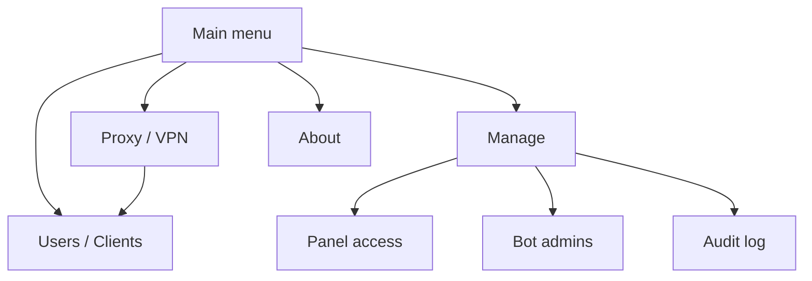

# Telegram Menu UX Design

**Goal:** Make the goVLESS Telegram bot usable as a daily control surface that mirrors the SSH menu and exposes the 90% common 3X-UI actions without pretending to support unsafe system operations.

## Product Rules

- Telegram follows the SSH mental model: `Proxy / VPN`, `Users / Clients`, `Manage`, `About`.
- Telegram exposes only operations that are already backed by safe govlessctl RPC or already exist in SSH in a bounded way.
- New system-level operations stay SSH-only until they have safe RPC, typed confirmation, audit, status reporting, and recovery guidance.
- Main buttons are one per row so they are easy to tap in Telegram mobile clients.
- Client links are sent as copyable text, not inline URL buttons, because Telegram rejects `vless://` button URLs.

## Top-Level Structure

## Telegram Functions

`Proxy / VPN` shows current mode, transport, Xray/3X-UI health, and inbound summaries. It links to users, full status, and marks mode/template switching as SSH-only.

`Users / Clients` shows clients with enabled/online state and traffic. A client card shows status, traffic, expiry, subscription availability, flow, UUID, and actions for VLESS link, QR, subscription URL, enable/disable, reset traffic, delete, and rotate subscription.

`Manage` contains panel access, bot admins, audit log, and SSH-only entries for repair, backup, 3X-UI update, remove, and mode/template switching.

`About` shows version, mode, transport, WebApp/tunnel status, and explains that Telegram mirrors the SSH menu and common client operations.

## Add Client UX

Adding a client is exposed as a button that opens an instruction screen plus `/addclient` command. This avoids a fragile multi-step conversational form while still giving the operator a quick path from the graphical menu. Invalid command input returns usage help and does not reset the user to the main menu.

## SSH-Only For Now

These are deliberately not implemented as Telegram actions in this patch: Lite/Pro mode switching, transport/template switching, repair routines, backup/restore, remove flows, update 3X-UI, raw inbound JSON editing, nginx/cert mutations, service restart/stop, and panel credential display.

## Verification

The patch must pass Python compile checks and `./test_regressions.sh`. The regression suite should include checks that the new menu labels exist, `vless://` is not used as an inline URL button, and the copyable link callback exists.
